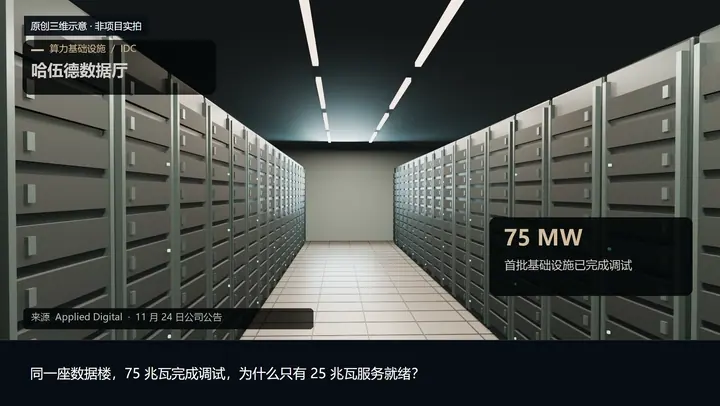
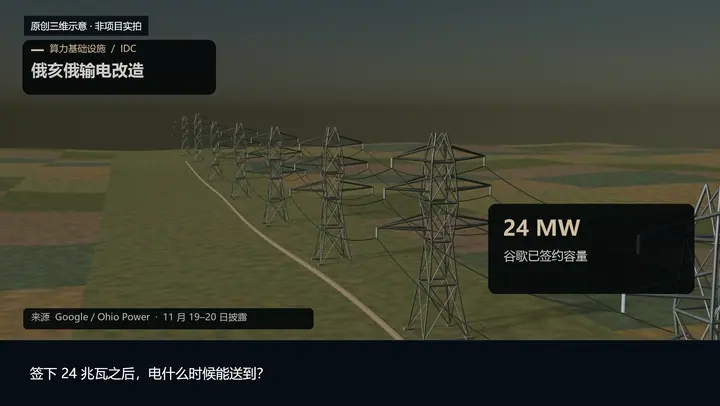
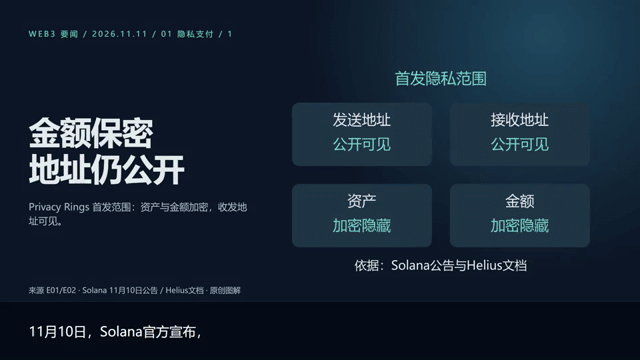

# Daily Media Lab

**Turn worthwhile technical work into everyday stories people can watch, hear, and verify.**

[简体中文 · Default](README.md) · [Watch and listen](previews/README.md) · [Getting started](docs/GETTING_STARTED.md) · [Contribute](CONTRIBUTING.md)

We write software and build products. Yet work that takes months to create can still be difficult for others to discover, understand, or remember.

Sometimes all we have is a document, an API key, and a little time after work. We want to introduce a project thoughtfully or make something useful for our technical community. Learning an entire stack of research, design, narration, and video tools can feel like another full-time job.

This repository starts with that need. It connects finding out what happened with explaining it to someone else: technical reporting with traceable sources, scripts that another tool can pick up, images and diagrams that help an idea land, clear narration, and carefully balanced music and captions.

We believe more technical people will develop a voice of their own. Models will change, and tools will come and go. What we can build together is a practice: getting the facts right, making the visuals understandable, caring for the sound, and leaving the next creator a better starting point.

If you want to make regular content for your project, team, or community, you are welcome here. A clearer diagram, a better sentence, or a thoughtful listening note can matter just as much as a code contribution.

## See the work

### Latest production record · IDC edition and workspace management

The 26 November 2026 IDC r1 edition was approved for release. Data, dates and evidence limits are placed beside the relevant equipment, transport module or evaluation bench. Short narration captions remain at the bottom. Both encodes decoded end to end and played at 1× through the last frame. The milestone includes measured immediate and cross-day storage cleanup. [Milestone record](docs/progress/2026-11-26-idc-publication-governance.md) · [E-drive governance replay](docs/progress/2026-11-26-e-drive-governance.md)

### Approved public preview · IDC production rehearsal

The maintainer approved the overall result on November 25, 2026. Both silent animations come from the reviewed edit and show original 3D illustrations.

#### Harwood data halls

The camera moves from a rack aisle to a cutaway of three halls in one building. It shows 75 MW of completed base-building commissioning, then reveals the first 25 MW hall ready for service. The remaining 50 MW is pending fit-out and delivery.



#### Ohio transmission upgrade

The shot highlights the proposed conductor replacement on the same transmission corridor. It shows Google's contracted 24 MW and the estimated two-year acceleration, subject to regulatory approval and construction completion.



The reviewed edit runs **39.625 seconds**. Project setup through delivery checks took **23 minutes and 6 seconds** with topics already selected. See the case sources, production evidence and plan for timing a full episode. [Milestone record](docs/progress/2026-11-25-idc-production-milestone.md)

### Archived preview · Web3 daily



**Images build intuition. Diagrams explain relationships. Sound carries the story forward.**

The preview comes from an actual Web3 daily production: two independent news sections in one roughly 93-second landscape video. It demonstrates the production workflow; it is an archived sample, not fresh reporting or independent security verification.

| Experience | Preview | What to notice |
| --- | --- | --- |
| Motion | [Silent clip](previews/editorial-silent.mp4) / GIF above | Images, diagrams, headlines and continuous captions |
| Visuals | [Selected frames](previews/contact-sheet.jpg) | Generated scenes provide context; graphics retain precise relationships |
| Music | [20-second excerpt](previews/music-preview.mp3) | Rhythm and atmosphere; music only, no narration |
| Narration and final mix | [Availability and listening notes](previews/README.md) | The local review package includes matched dry/mixed excerpts and the full voiced sample; excluded from Git until voice publication rights are confirmed |
| Handoff | [Workflow](docs/WORKFLOW.md) | How sources, scenes, assets and captions stay connected |

Music: “Voice Over Under” by Kevin MacLeod, [source](https://incompetech.com/music/royalty-free/index.html?isrc=USUAN1600001), [CC BY 4.0](https://creativecommons.org/licenses/by/4.0/). The excerpt is trimmed, faded and transcoded. [Credits](THIRD_PARTY_NOTICES.md). The README uses GIF and downloadable media links.

## Why this repository exists

**Technical work needs a way to be understood.** A repository URL rarely explains who a project helps or why an engineering decision matters. We want maintainers and small teams to communicate their work clearly. We do not promise reach, growth, or commercial results.

**An API key is a starting point, not a production workflow.** Research, image composition, pronunciation, caption timing and music levels still need to fit together. Here, the instructions, scripts and intermediate artifacts live together so a generation can become something inspectable and editable. Today, a key alone is insufficient: image generation uses a compatible Images API, narration requires local Qwen3-TTS and CUDA, with an explicitly selectable public built-in speaker that needs no private recording, Blender creates narrative shots, and Remotion plus FFmpeg compose the result. A licensed final dry vocal with accurate cues can use external_final without TTS or repeated voice processing.

**Limited time belongs with editorial judgment.** Reusable assets and readable configuration can reduce repeated tool work. Creators should have more time to ask whether a claim is true, whether it matters, and whether the explanation is understandable. Failures should leave useful intermediate results and a clear reason.

**The workflow should survive changes in models.** Keeping sources, scripts, images, sound and production parameters separate gives us a chance to replace one part without discarding everything. We want practical media capability that individuals and small teams can maintain over time.

**More people should be able to contribute.** Editing, illustration, audio, translation and accessibility all improve technical communication. Contributions in these areas belong alongside code.

## Three skills, one video entry point

| Skill | Responsibility | Delivery boundary |
| --- | --- | --- |
| [`news-to-video`](skills/news-to-video/SKILL.md) | Domain coordination, episode editing, narrative direction, frozen speech, Blender shots and composition | A recent IDC/Web3 video request continues to an MP4; confirmed scripts and final vocals can enter directly |
| [`idc-compute-news-digest`](skills/idc-compute-news-digest/SKILL.md) | Primary-source verification, construction/power/cooling/compute boundaries and seven-day deduplication | Standalone script or explicit text; an evidence package when delegated by the video entry point |
| [`web3-tech-news-digest`](skills/web3-tech-news-digest/SKILL.md) | Protocol/version/trust/application evidence, deduplication and roadmap tracking | Standalone script or explicit text; an evidence package when delegated |

```text
Recent IDC/Web3 video request → domain evidence package → edited and locked script
                                                          ↓
                                  generate and freeze speech / reuse a final dry vocal
                                                          ↓
                     reference/design review → joint animatic → Blender masters → Remotion composition
                                                          ↓
                           checks and actual delivery → one MP4 → idempotent adoption
```

The user no longer carries intermediate scripts between skills. Load only the relevant domain; mixed episodes use both and retain independent story worlds without invented causality. New internal drafts remain editable until lock. Confirmed scripts and final speech preserve their identities. Explicit text/script/plan/image-only requests stop at that output; discussing examples does not execute them.

The current repair adds [design consumption before modeling](skills/news-to-video/references/visual-director.md#建模前参考与设计消费) and a [project joint-direction entry](skills/news-to-video/references/blender-handoff.md#项目联合导演接入): verify recognizable objects and the actual text composition, then share frames and semantic events across camera, graphics and sound, with camera projections where needed. `narrative_directing` currently targets two concrete project panels; it is not a general automatic director. Consumer tests and actual animatic review remain separate. See the [repair record](docs/progress/2026-11-20-joint-directing-v3.md) for executed and unverified work; archived previews do not validate this repair.

The format remains 1920×1080 at 24fps with a fixed y904—1080 caption rail. Full Blender shots keep their aspect ratio and bypass old object-stage slots; legacy diagrams remain compatible. Images are optional, with at most 10 new paid attempts per episode. See the [workflow](docs/WORKFLOW.md), [minimal synthetic example](examples/three-media-minimal/README.md) and [current integration evidence](docs/progress/2026-11-20-three-media-blender.md). See the [latest milestone](docs/progress/2026-11-26-idc-publication-governance.md) for the applied Blender workflow.

## Give images and sound a purpose

**Visuals should tell the story.** Combine observation, explanation and metaphor through space, materials, light, camera and motion. Extruding icons is not a substitute for narrative direction. Use verified materials, generated illustrations, SVGs, charts or text where they serve the content, without an image quota. Generated illustrations are never evidence of a real deployment or event.

**Narration needs more than readable text.** Public synthesis examples explicitly choose `qwen-uncle-fu-v1` with its [separate setup](skills/news-to-video/references/public-voice.md), without a private reference. Licensed final dry vocals can use `external_final`: verify the hash, sample metadata, completed processing identity and accurate cues, keep playback at 1.0, and skip TTS, tempo/noise processing and segment restitching. The private B voice remains excluded; neither voice is an automatic fallback.

**Mixing should protect speech.** Select a track and its entry/exit for the story, including silence. Speech-active RMS balance, an initial -19dB relative level and 2dB ducking are starting points; fades, attribution and actual listening still matter.

**Ambience and effects need restraint.** Independent `sound_tracks` identify source, license, content hash, timing, level and purpose. Designed sound must not pose as site recording. Code and timeline checks are separate from continuous viewing, headphone/speaker listening and user approval.

## Start small

1. Watch the preview and decide whether the format suits your material.
2. Ask a local-skill-capable agent to read `news-to-video` and load the IDC or Web3 skill only when needed. Use the repository as the workspace and retain `news/` and its audit documents.
3. Start with a script or image plan; configure the full runtime only when you need video. See [setup](docs/GETTING_STARTED.md).

Example request:

> Use web3-tech-news-digest to prepare one episode about recent changes that matter to DApp developers. Keep primary sources, deployment states, paragraph/evidence IDs and necessary material constraints. Do not produce media yet.

> Use news-to-video to research and produce one recent IDC/Web3 episode. Continue to a finished video and explicitly select qwen-uncle-fu-v1 for public synthesis. Preserve confirmed scripts or final vocals when supplied.

## Build the next episode with us

Start with a pronunciation correction, an awkward caption, a stronger source, a better diagram, or the first issue you encounter on a fresh machine. Concrete examples and honest feedback are welcome.

Priorities include fresh-machine installation, a complete public real-domain example, narrative reuse across topics, full listening review, bilingual production and more domains. The current integration record states which layers were actually tested; code presence does not establish perceptual quality or a clean-machine install. [Contribute](CONTRIBUTING.md) · [Roadmap](ROADMAP.md).

## Pick a first contribution

Start with one bounded task; reading examples, caption feedback and SVG work need no GPU.

- [Chinese reading examples](https://github.com/leongaooo/daily-media-lab/issues/1) · `EXP-02-01`
- [CPU-only test CI](https://github.com/leongaooo/daily-media-lab/issues/2) · `REP-04-01`
- [Mobile caption feedback](https://github.com/leongaooo/daily-media-lab/issues/3) · `EXP-02-02`
- [Independent Windows/CUDA setup](https://github.com/leongaooo/daily-media-lab/issues/4) · `REP-02-01`
- [One original SVG diagram](https://github.com/leongaooo/daily-media-lab/issues/5) · `EXP-01-01`

[Scopes and acceptance](docs/community/README.md) · [New issue](https://github.com/leongaooo/daily-media-lab/issues/new/choose)

Public built-in voice: [accepted default sample and native-speed comparison](examples/public-voice-smoke/README.md).

## Status and licensing

This is an experimental snapshot of a working local workflow. Fresh-machine end-to-end installation is unverified. The maintainer approved the overall result of the latest IDC rehearsal. Cross-device listening and the one-hour full-episode target still need testing. The [earlier repair record](docs/progress/2026-11-20-joint-directing-v3.md) preserves feedback on the initial Blender candidates. REP-01 listening approval covers its specific public voice sample.

Before any new batch changes to the three media skills, ask whether to sync the maintainer-configured public copy. Reuse an explicit answer within that batch; ordinary research or production adds no such prompt. See the [maintenance contract](skills/news-to-video/references/media-maintenance.md).

Project-owned code and documentation use the [MIT License](LICENSE). The maintainer has confirmed public distribution of the existing preview images; private voice materials and voiced samples remain excluded. Music, models, Remotion, fonts and other third-party materials retain their own terms. [Release preparation](docs/RELEASE_PREPARATION.md).
