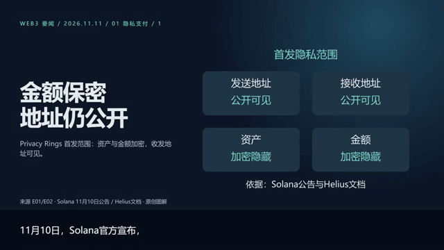

# Daily Media Lab

**Turn worthwhile technical work into everyday stories people can watch, hear, and verify.**

[简体中文 · Default](README.md) · [Watch and listen](previews/README.md) · [Getting started](docs/GETTING_STARTED.md) · [Contribute](CONTRIBUTING.md)

We write software and build products. Yet work that takes months to create can still be difficult for others to discover, understand, or remember.

Sometimes all we have is a document, an API key, and a little time after work. We want to introduce a project thoughtfully or make something useful for our technical community. Learning an entire stack of research, design, narration, and video tools can feel like another full-time job.

This repository starts with that need. It connects finding out what happened with explaining it to someone else: technical reporting with traceable sources, scripts that another tool can pick up, images and diagrams that help an idea land, clear narration, and carefully balanced music and captions.

We believe more technical people will develop a voice of their own. Models will change, and tools will come and go. What we can build together is a practice: getting the facts right, making the visuals understandable, caring for the sound, and leaving the next creator a better starting point.

If you want to make regular content for your project, team, or community, you are welcome here. A clearer diagram, a better sentence, or a thoughtful listening note can matter just as much as a code contribution.

## See the work



**Images build intuition. Diagrams explain relationships. Sound carries the story forward.**

The preview comes from an actual Web3 daily production: two independent news sections in one roughly 93-second landscape video. It demonstrates the production workflow; it is an archived sample, not fresh reporting or independent security verification.

| Experience | Preview | What to notice |
| --- | --- | --- |
| Motion | [Silent clip](previews/editorial-silent.mp4) / GIF above | Images, diagrams, headlines and continuous captions |
| Visuals | [Selected frames](previews/contact-sheet.jpg) | Generated scenes provide context; graphics retain precise relationships |
| Music | [20-second excerpt](previews/music-preview.mp3) | Rhythm and atmosphere; music only, no narration |
| Narration and final mix | [Availability and listening notes](previews/README.md) | The local review package includes matched dry/mixed excerpts and the full voiced sample; excluded from Git until voice publication rights are confirmed |
| Handoff | [Workflow](docs/WORKFLOW.md) | How sources, scenes, assets and captions stay connected |

Music: “Voice Over Under” by Kevin MacLeod, [source](https://incompetech.com/music/royalty-free/index.html?isrc=USUAN1600001), [CC BY 4.0](https://creativecommons.org/licenses/by/4.0/). The excerpt is trimmed, faded and transcoded. [Credits](THIRD_PARTY_NOTICES.md). The README uses GIF and downloadable media links.

## Why this repository exists

**Technical work needs a way to be understood.** A repository URL rarely explains who a project helps or why an engineering decision matters. We want maintainers and small teams to communicate their work clearly. We do not promise reach, growth, or commercial results.

**An API key is a starting point, not a production workflow.** Research, image composition, pronunciation, caption timing and music levels still need to fit together. Here, the instructions, scripts and intermediate artifacts live together so a generation can become something inspectable and editable. Today, a key alone is insufficient: image generation uses a compatible Images API, narration requires local Qwen3-TTS and CUDA, with an explicitly selectable public built-in speaker that needs no private recording, and video uses local Remotion and FFmpeg.

**Limited time belongs with editorial judgment.** Reusable assets and readable configuration can reduce repeated tool work. Creators should have more time to ask whether a claim is true, whether it matters, and whether the explanation is understandable. Failures should leave useful intermediate results and a clear reason.

**The workflow should survive changes in models.** Keeping sources, scripts, images, sound and production parameters separate gives us a chance to replace one part without discarding everything. We want practical media capability that individuals and small teams can maintain over time.

**More people should be able to contribute.** Editing, illustration, audio, translation and accessibility all improve technical communication. Contributions in these areas belong alongside code.

## Two skills, one handoff

| Skill | Responsibility | Output |
| --- | --- | --- |
| [`web3-tech-news-digest`](skills/web3-tech-news-digest/SKILL.md) | Research, primary-source checks, dates and deployment states, seven-day deduplication, scene writing | Narration, on-screen text, evidence IDs, asset IDs and image prompts |
| [`news-to-video`](skills/news-to-video/SKILL.md) | Script intake, images and SVGs, narration, music mixing, caption timing and local rendering | MP4, SRT, dry voice, mixed audio, storyboard and production/validation records |

```text
Primary sources → verification → scene script + image briefs
                                            ↓
                          images / diagrams / local narration
                                            ↓
                             music + captions + editorial shots
                                            ↓
                           one episode + editable project + checks
```

Web3 is the first editorial topic. The production skill can also accept existing product materials or narration scripts. Other editorial topics are future contributions. Script-only requests do not invoke image generation, speech synthesis or rendering. One daily script produces one project, one continuous timeline and one final video by default.

Production now covers general news in a single 1920×1080 landscape mode with a fixed bottom caption rail. Approved narration and voice identity stay intact while images, SVGs and animation follow a coherent story world and measured captions. Each episode allows up to 10 paid image attempts; cache reuse does not count. Reusable asset manifests and production records accompany the project. See the [visual director contract](skills/news-to-video/references/visual-director.md). Existing previews have not been remade; the new visuals still need finished-video review.

## Give images and sound a purpose

**Images should earn their place.** Each scene has one understanding goal. Choose verified materials, generated illustrations, original SVGs, charts or text accordingly. Use scene images for context and visual memory; keep numbers, arrows and factual relationships controllable. Generated illustrations are never evidence of a real deployment or event.

**Narration needs more than readable text.** Caption text and `spoken` text can differ to handle acronyms, numbers and pronunciation. The current B male voice uses reference-conditioned local generation, 1.15× pitch-preserving playback and mild noise reduction. Captions follow the processed audio. The private reference is not distributed. An explicit public built-in voice, `qwen-uncle-fu-v1`, has a [separate setup](skills/news-to-video/references/public-voice.md). Neither voice acts as an automatic fallback.

**Mixing should protect the speaker.** The current default pool selects among three tracks. Music is balanced against speech-active RMS, normally 19 dB below speech with another 2 dB of ducking. Fades and attribution are part of the output. These checks do not replace listening on headphones and a phone.

**Sound effects are an invitation to build.** Narration, music and mixing exist today. A separate transition, notification or foley event track does not. We welcome licensed assets, restrained event design, level policies and audible before/after examples.

## Start small

1. Watch the preview and decide whether the format suits your material.
2. Ask a local-skill-capable agent to read the two `SKILL.md` files. Use the repository as the workspace and retain `news/` and its audit documents.
3. Start with a script or image plan; configure the full runtime only when you need video. See [setup](docs/GETTING_STARTED.md).

Example request:

> Use web3-tech-news-digest to prepare one episode about recent changes that matter to DApp developers. Keep primary sources, deployment states, scene IDs and actionable image briefs. Do not produce media yet.

> Use news-to-video to produce one video from the approved script. Preserve narration, evidence IDs and asset IDs. Label generated illustrations and deliver captions, dry voice, the mix and validation records.

## Build the next episode with us

Start with a pronunciation correction, an awkward caption, a stronger source, a better diagram, or the first issue you encounter on a fresh machine. Concrete examples and honest feedback are welcome.

Priorities include fresh-machine installation, a complete Web3 example, sound-effect events, bilingual production and more editorial topics. These are plans, not implemented features. [Contribute](CONTRIBUTING.md) · [Roadmap](ROADMAP.md).

## Pick a first contribution

Start with one bounded task; reading examples, caption feedback and SVG work need no GPU.

- [Chinese reading examples](https://github.com/leongaooo/daily-media-lab/issues/1) · `EXP-02-01`
- [CPU-only test CI](https://github.com/leongaooo/daily-media-lab/issues/2) · `REP-04-01`
- [Mobile caption feedback](https://github.com/leongaooo/daily-media-lab/issues/3) · `EXP-02-02`
- [Independent Windows/CUDA setup](https://github.com/leongaooo/daily-media-lab/issues/4) · `REP-02-01`
- [One original SVG diagram](https://github.com/leongaooo/daily-media-lab/issues/5) · `EXP-01-01`

[Scopes and acceptance](docs/community/README.md) · [New issue](https://github.com/leongaooo/daily-media-lab/issues/new/choose)

Public built-in voice: [accepted default sample and native-speed comparison](examples/public-voice-smoke/README.md).

## Status and licensing

This is an experimental snapshot of a working local workflow. Fresh-machine end-to-end installation is unverified. The legacy B voice still pins private reference hashes. A separate public built-in voice configuration and smoke project are available; the maintainer accepted the overall sound of the current default-speed sample (REP-01), while new scripts still need listening review.

Project-owned code and documentation use the [MIT License](LICENSE). The maintainer has confirmed public distribution of the existing preview images; private voice materials and voiced samples remain excluded. Music, models, Remotion, fonts and other third-party materials retain their own terms. [Release preparation](docs/RELEASE_PREPARATION.md).
