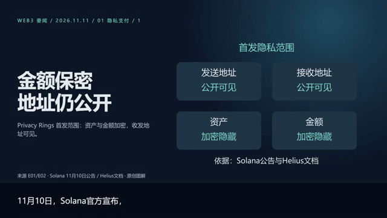

# Daily Media Lab · 日常媒体实验室

**把值得分享的技术，做成有人愿意看、愿意听、也能查证的日常内容。**

[English](README.en.md) · [看画面与听声音](previews/README.md) · [开始使用](docs/GETTING_STARTED.md) · [参与建设](CONTRIBUTING.md)

我们写代码、做产品，也经常遇到同一个问题：花了很多时间做出来的东西，却很难被别人看见、理解和记住。

有时候，我们手里只有一份资料、一个 API Key，以及下班后不多的时间。我们想认真介绍自己的项目，想为所在的技术社区做一点日常内容，却没有精力重新学习一整套采编、设计、配音和视频制作工具。

这个仓库从这样的需要出发。我们把“查清楚发生了什么”和“把它讲给人听”连接起来：保留来源的技术资讯、可以交接的分幕剧本、帮助理解的图片与图解、清楚自然的配音，以及有节制的音乐和字幕。

我们相信，未来会有更多技术人拥有自己的表达方式。模型会继续变化，工具也会不断更替；值得共同积累的，是怎样把事情说准确、把画面做明白、把声音照顾好，再让下一位创作者少走一点弯路。

如果你也想为自己的项目、团队或社区持续做点内容，欢迎从这里开始。贡献一张好图、一句更好的口播、一段声音反馈，和提交代码一样有价值。

## 先看成果



**图片建立直觉，图解说明关系，声音带着观众往下走。**

这不是概念效果图：预览来自一份实际制作的 Web3 日报，两个独立新闻板块合成一条约 93 秒的横屏视频。这里展示制作样式与交接成果，不把历史样片当作当前新闻或独立安全验证。

| 想看什么 | 预览入口 | 可以观察什么 |
| --- | --- | --- |
| 动态画面 | [静音短片](previews/editorial-silent.mp4) / 上方 GIF | 图片、流程图、标题与连续字幕怎样配合 |
| 图片与图解 | [画面选集](previews/contact-sheet.jpg) | 生成场景提供视觉锚点，准确关系由图形和文字表达 |
| 配乐质感 | [20 秒配乐试听](previews/music-preview.mp3) | 节奏与空间感；这条是单独的音乐片段，不含配音 |
| 配音、混音、完整视频 | [试听说明与当前状态](previews/README.md) | 本地审阅包提供同段干声/混音 A/B 和完整有声样片；声音公开授权确认前不纳入 Git |
| 从输入到交付 | [工作流](docs/WORKFLOW.md) | 同一期的来源、幕号、素材与字幕如何衔接 |

音乐：“Voice Over Under” — Kevin MacLeod，来源 [incompetech](https://incompetech.com/music/royalty-free/index.html?isrc=USUAN1600001)，采用 [CC BY 4.0](https://creativecommons.org/licenses/by/4.0/)。试听做了截取、淡入淡出和 MP3 转码。[完整署名](THIRD_PARTY_NOTICES.md)。README 以 GIF 和文件链接提供预览，音视频文件可下载播放。

## 为什么需要这个仓库

### 做出了东西，还需要让别人理解

一个开源项目、一次版本更新、一项工程实践，常常需要比仓库链接多一点解释。我们希望技术人能把“解决了谁的什么问题”讲清楚，也让没有参与开发的人有机会看懂它的价值。内容可以帮助项目交流和社区传播，但不承诺流量、增长或商业转化。

### 有 API Key，还缺一条能够走通的工作流

模型入口变多了，选题、核验、图片构图、缩写读法、字幕计时和音乐音量之间的空隙依然存在。我们把这些协作规则、制作脚本和交付文件放在一起，让一次调用可以成为可检查、可修改、能继续制作的作品。

API Key 是一种起点，不是全部运行条件。图片生成使用兼容的 Images API；配音依赖本地 Qwen3-TTS 和 CUDA，可显式使用无需私人参考的公开内置音色，视频依赖本地 Remotion 与 FFmpeg。**当前版本还不能让陌生用户仅填一个 Key 就完整出片。** 公开声音的[配置与短样本](skills/news-to-video/references/public-voice.md)已接入，首装仍待验证。

### 把有限的时间留给内容判断

不必为了介绍一次更新就从头研究音频工程和渲染管线。可读的配置、可复用的素材和明确的输出，帮助我们减少重复摸索，把精力放在“这件事真实吗、值得说吗、这样表达容易理解吗”。失败也应该留下清楚的原因与可继续的中间结果。

### 面向模型不断变化的未来

将来源、剧本、图片、声音和制作参数分开保存，下一次工具变化时才有机会替换某一环。我们希望把经过真实制作检验的方法积累下来，让个人与小团队能够持续建设自己的媒体能力，而不必每次从一次性提示词重新开始。

### 让更多角色一起建设

好的技术内容也需要编辑、设计、声音、翻译与无障碍经验。这个仓库欢迎这些贡献进入同一条工作流：一处事实纠正、一张关系更清楚的图、一条发音修正，都能改善下一期内容。

## 两个技能，怎样配合

| 技能 | 负责什么 | 交给下一环什么 |
| --- | --- | --- |
| [`web3-tech-news-digest`](skills/web3-tech-news-digest/SKILL.md) | 发现线索、读取一手材料、核对日期/状态、七日去重、写成分幕剧本 | 口播、屏幕文字、证据编号、素材 ID、逐图正负提示词 |
| [`news-to-video`](skills/news-to-video/SKILL.md) | 接收剧本、准备图片与 SVG、合成配音、配乐混音、字幕计时、本地渲染 | MP4、SRT、干声、混音、分镜与制作/验证记录 |

```text
一手来源 → 核验与去重 → 分幕剧本 + 图片需求
                              ↓
                图片 / 原创图解 / 本地配音
                              ↓
                  配乐 + 连续字幕 + 镜头
                              ↓
                一期视频 + 可编辑工程 + 检查记录
```

Web3 是第一个采编方向；制作技能也可接收已有产品材料或口播稿。其他领域的采编适配是社区可以继续建设的方向。只要剧本时不会启动生图、配音或渲染；一份日报默认一个项目、一条连续时间线和一个成片。

## 图片与声音，值得认真做

**图片不是填空。** 每幕先明确一个理解目标，再选择真实素材、生成示意、原创 SVG、图表或主题文字。场景图帮助认识对象、感受环境；节点、箭头、数字和来源保留可控的表达。生成示意不冒充现场照片，准确品牌与产品外观优先用核实素材。

**配音不是读完文字。** 字幕保留适合阅读的原文，`spoken` 处理缩写、数字和中文读法。当前 B 版男声采用参考条件生成，默认 1.15 倍保留音高变速与轻度降噪；字幕按处理后的实际音频重建。私人参考不随仓库分发。另可显式选择公开内置男声 `qwen-uncle-fu-v1`；两者不自动回退。

**混音让人声始终站在前面。** 当前音乐池包含三首默认候选，按人声活跃段 RMS 配平，默认低于人声 19 dB，并在人声期间额外避让 2 dB，保留淡入淡出。工程会生成音乐署名。参数和解码检查不能代替耳机、手机试听。

**音效是下一块可以共同建设的能力。** 当前已实现配音、配乐和混音，尚无独立转场、提示音或拟音事件轨。我们欢迎带许可信息、音量策略和可试听对照的音效方案，尤其是能帮助理解、不过度抢占注意力的设计。

## 从这里开始

1. 先看预览，判断这种表达方式是否适合你的内容。
2. 让支持本地技能的代理读取两个 `SKILL.md`；从仓库工作区使用，保留根目录 `news/` 与审计文档。
3. 先尝试只生成剧本，或用已有剧本准备图片；需要完整视频时再按[环境说明](docs/GETTING_STARTED.md)配置运行时。

可以这样提出第一个任务：

> 使用 web3-tech-news-digest，整理最近一周对 DApp 开发者有实际影响的技术变化。给我一期分幕剧本，保留一手来源、事件状态和每张图片的生成要求。先不制作媒体。

> 使用 news-to-video，按已确认的剧本制作一期视频。沿用口播、证据编号和素材 ID。图片标注生成示意，交付字幕、干声、混音和验证记录。

## 一起把下一期做好

可以从一件很小的事开始：修正一次术语读音、反馈一处字幕换行、补充一个来源、设计一张图，或者记录新机器安装时的第一个卡点。我们欢迎真实样本与具体反馈。

近期优先：全新机器安装验证、可直接使用的 Web3 样例工程、音效事件轨、双语制作和更多领域采编适配。上述未完成事项见计划；公开声音短样本已完成验收。[贡献方式](CONTRIBUTING.md) · [计划](ROADMAP.md)。

## 从这里贡献

先选一件小事：读法样例、字幕反馈和单张SVG都无需GPU。

- [补充10组中文读法](https://github.com/leongaooo/daily-media-lab/issues/1) · `EXP-02-01`
- [无GPU测试CI](https://github.com/leongaooo/daily-media-lab/issues/2) · `REP-04-01`
- [手机字幕反馈](https://github.com/leongaooo/daily-media-lab/issues/3) · `EXP-02-02`
- [第二台Windows/NVIDIA复现](https://github.com/leongaooo/daily-media-lab/issues/4) · `REP-02-01`
- [单张原创SVG](https://github.com/leongaooo/daily-media-lab/issues/5) · `EXP-01-01`

[任务范围与验收](docs/community/README.md) · [新建Issue](https://github.com/leongaooo/daily-media-lab/issues/new/choose)

公开声音：[已获认可的默认短样本与原速对照](examples/public-voice-smoke/README.md)。

## 当前状态与许可

这是从本地实际使用流程整理的实验性开源准备版，尚未完成全新机器端到端安装验证。私人 B 声仍锁定参考；公开内置声音已有独立配置入口和短测试工程，维护者已认可当前短样本整体听感，见 REP-01；新文稿仍需试听。

项目自有代码与文档采用 [MIT](LICENSE)。维护者已确认现有预览图片可公开分发；私人声音及完整有声样片继续排除。第三方音乐、模型、Remotion、字体与其他素材各自适用其许可，不能被项目代码许可覆盖。[发布准备记录](docs/RELEASE_PREPARATION.md)。
