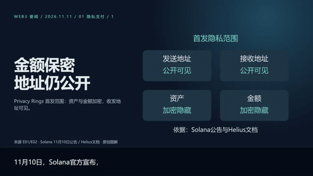

# Daily Media Lab · 日常媒体实验室

**把值得分享的技术，做成有人愿意看、愿意听、也能查证的日常内容。**

[English](README.en.md) · [看画面与听声音](previews/README.md) · [开始使用](docs/GETTING_STARTED.md) · [参与建设](CONTRIBUTING.md)

我们写代码、做产品，也经常遇到同一个问题：花了很多时间做出来的东西，却很难被别人看见、理解和记住。

有时候，我们手里只有一份资料、一个 API Key，以及下班后不多的时间。我们想认真介绍自己的项目，想为所在的技术社区做一点日常内容，却没有精力重新学习一整套采编、设计、配音和视频制作工具。

这个仓库从这样的需要出发。我们把“查清楚发生了什么”和“把它讲给人听”连接起来：保留来源的技术资讯、可以交接的分幕剧本、帮助理解的图片与图解、清楚自然的配音，以及有节制的音乐和字幕。

我们相信，未来会有更多技术人拥有自己的表达方式。模型会继续变化，工具也会不断更替；值得共同积累的，是怎样把事情说准确、把画面做明白、把声音照顾好，再让下一位创作者少走一点弯路。

如果你也想为自己的项目、团队或社区持续做点内容，欢迎从这里开始。贡献一张好图、一句更好的口播、一段声音反馈，和提交代码一样有价值。

## 先看成果

### 混合分镜透明覆盖 · 2026-11-28

SVG 标注叠加 Blender 时逐像素验证透明区与原始底图，并检查预期动作窗口。公开 IDC 示例用同一封存母版生成带声与静音两版，验证两版各 200 帧的完整解码、音流和字幕设置。[验证记录](docs/progress/2026-11-28-mixed-shot-transparency.md) · [可复现示例](examples/idc-mixed-shot/README.md)



**图片建立直觉，图解说明关系，声音带着观众往下走。**

这不是概念效果图：预览来自一份实际制作的 Web3 日报，两个独立新闻板块合成一条约 93 秒的横屏视频。这里展示制作样式与交接成果，不把历史样片当作当前新闻或独立安全验证。

| 想看什么 | 预览入口 | 可以观察什么 |
| --- | --- | --- |
| 动态画面 | [静音短片](previews/editorial-silent.mp4) / 上方 GIF | 图片、流程图、标题与连续字幕怎样配合 |
| 图片与图解 | [画面选集](previews/contact-sheet.jpg) | 生成场景提供视觉锚点，准确关系由图形和文字表达 |
| 配乐质感 | [20 秒配乐试听](previews/music-preview.mp3) | 节奏与空间感；这条是单独的音乐片段，不含配音 |
| 配音、混音、完整视频 | [试听说明与当前状态](previews/README.md) | 本地审阅包提供同段干声/混音 A/B 和完整有声样片；声音公开授权确认前不纳入 Git |
| 从输入到交付 | [工作流](docs/WORKFLOW.md) | 同一期的来源、幕号、素材与字幕如何衔接 |

音乐：“Voice Over Under” — Kevin MacLeod，来源 [incompetech](https://incompetech.com/music/royalty-free/index.html?isrc=USUAN1600001)，采用 [CC BY 4.0](https://creativecommons.org/licenses/by/4.0/)。试听做了截取、淡入淡出和 MP3 转码。[完整署名](THIRD_PARTY_NOTICES.md)。README 以 GIF 和文件链接提供预览，音视频文件可下载播放。

## 为什么需要这个仓库

### 做出了东西，还需要让别人理解

一个开源项目、一次版本更新、一项工程实践，常常需要比仓库链接多一点解释。我们希望技术人能把“解决了谁的什么问题”讲清楚，也让没有参与开发的人有机会看懂它的价值。内容可以帮助项目交流和社区传播，但不承诺流量、增长或商业转化。

### 有 API Key，还缺一条能够走通的工作流

模型入口变多了，选题、核验、图片构图、缩写读法、字幕计时和音乐音量之间的空隙依然存在。我们把这些协作规则、制作脚本和交付文件放在一起，让一次调用可以成为可检查、可修改、能继续制作的作品。

API Key 是一种起点，不是全部运行条件。图片生成使用兼容的 Images API；配音依赖本地 Qwen3-TTS 和 CUDA，可显式使用无需私人参考的公开内置音色，三维镜头依赖本地 Blender，字幕与合成依赖 Remotion 和 FFmpeg。已有合法最终干声和准确cue可走external_final，不安装TTS或重复处理音频。**当前版本还不能让陌生用户仅填一个 Key 就完整出片。** 公开声音的[配置与短样本](skills/news-to-video/references/public-voice.md)已接入，首装仍待验证。

### 把有限的时间留给内容判断

不必为了介绍一次更新就从头研究音频工程和渲染管线。可读的配置、可复用的素材和明确的输出，帮助我们减少重复摸索，把精力放在“这件事真实吗、值得说吗、这样表达容易理解吗”。失败也应该留下清楚的原因与可继续的中间结果。

### 面向模型不断变化的未来

将来源、剧本、图片、声音和制作参数分开保存，下一次工具变化时才有机会替换某一环。我们希望把经过真实制作检验的方法积累下来，让个人与小团队能够持续建设自己的媒体能力，而不必每次从一次性提示词重新开始。

### 让更多角色一起建设

好的技术内容也需要编辑、设计、声音、翻译与无障碍经验。这个仓库欢迎这些贡献进入同一条工作流：一处事实纠正、一张关系更清楚的图、一条发音修正，都能改善下一期内容。

制作端支持通用资讯，统一1920×1080、24fps和y904—1080固定字幕轨。三维主视觉由Blender建立故事世界，Remotion负责镜头、字幕、来源和声音合成；旧图解项目继续兼容。画面保留原比例，不把完整镜头压入旧对象槽。每期最多10次新的付费生图尝试，图片不是必需配额。新路线的实际运行和未验收范围见 [本批记录](docs/progress/2026-11-20-three-media-blender.md)；上方历史预览不作为新Blender成片证据。

## 三个技能，一个成片入口

| 技能 | 负责什么 | 交付边界 |
| --- | --- | --- |
| [`news-to-video`](skills/news-to-video/SKILL.md) | 按需领域核验、整期编辑、叙事导演、声音冻结、Blender镜头及合成 | 近期IDC／Web3视频请求持续到MP4；已有确认稿／音频也可直接接入 |
| [`idc-compute-news-digest`](skills/idc-compute-news-digest/SKILL.md) | 数据中心建设、供电、冷却、算力与采购的原文核验和七日去重 | 独立调用交剧本／明确文字版；受总入口委派返回证据编辑包 |
| [`web3-tech-news-digest`](skills/web3-tech-news-digest/SKILL.md) | 协议、版本、信任边界、应用和技术路线的核验、去重与tracker | 独立调用交剧本／明确文字版；受总入口委派返回证据编辑包 |

```text
近期IDC／Web3视频请求 → 对应领域证据编辑包 → 整期编辑与稿件锁定
                                               ↓
                           新口播生成并冻结／已有最终干声直接接入
                                               ↓
                    参考与设计确认 → 联合预演 → Blender母版 → Remotion合成
                                               ↓
                      检查与实际交付 → 一个MP4／字幕／工程 → 幂等采用
```

不再要求用户手工先做新闻再交接视频。领域分别维护来源与台账，混合一期才同时使用两领域；各条新闻保留独立主线，不强造因果。新稿可在定稿前内部校订，确认稿和最终音频保持身份保护。明确只要文字、剧本、计划或图片时到指定产物停止；讨论示例不启动制作。详见 [工作流](docs/WORKFLOW.md) 与 [最小合成示例](examples/three-media-minimal/README.md)。

### 日更编辑入口

IDC 日更先记录一个观众问题、一句可复述的收获、工程进展/技术运维/采购供应链切入点、表达方式、可直接发布的标题和可选互动，再进入 `episode.py init --editorial-plan`。方向建议保留原意和工作场景，由人工方向研讨委员会记录采纳、补证后再议或暂存理由。抖音导出和评论只在用户明确说“复盘”后读取。契约、结构校验和示例见 [日更编辑工作流](skills/news-to-video/references/daily-editorial-workflow.md)。

本批正在补齐[建模前设计消费](skills/news-to-video/references/visual-director.md#建模前参考与设计消费)与[项目联合导演入口](skills/news-to-video/references/blender-handoff.md#项目联合导演接入)：先核对可辨主体及实际文字构图，再用共享帧／语义事件联动摄影、解释图形与声音；需要时从当前相机导出锚点。`narrative_directing` 是具体项目消费入口，当前两类板面不构成全题材自动导演。新接口回归和实际预演分开验收，进展见[返修记录](docs/progress/2026-11-20-joint-directing-v3.md)，不以历史预览证明本批质量。

## 图片与声音，值得认真做

**画面要承担叙事。** 按内容组合观察、解释和隐喻，用空间、材质、光线、摄影与动作形成联想和观看节奏；不把几个图标立起来当成三维叙事。真实素材、生成示意、原创SVG、图表与文字各按用途选择，不强制每幕生图。生成示意不冒充现场照片，准确品牌与产品外观优先用核实素材。

**配音不是读完文字。** 字幕保留适合阅读的原文，`spoken` 处理缩写、数字和中文读法。公开新配音示例显式选择 `qwen-uncle-fu-v1`，使用独立的 [公开声音配置](skills/news-to-video/references/public-voice.md)，无需私人参考。已取得合法最终干声时可选 `external_final`，核验内容哈希、样本身份、已完成处理和准确cue，播放倍率固定1.0，跳过TTS、再变速、再降噪和分段重拼。本机私人B声仍受保护、不分发；不同声音不自动回退，不能因默认B声而替换公开选择。

**混音让人声始终站在前面。** 按叙事选择明确曲目和进入／退出时机，允许留白；按人声活跃段RMS配平，-19dB与额外2dB避让只是初始参考，保留淡入淡出。工程会生成音乐署名。参数和解码检查不能代替耳机、手机试听。

**环境音和音效应有分寸。** 独立sound_tracks记录来源、许可、内容哈希、时机、音量及叙事作用；设计声音不冒充现场录音。代码与时间线检查不等于逐段试听，完整耳机／普通扬声器与用户认可分别记录。欢迎提供有许可和可试听对照的具体改进。

## 从这里开始

1. 先看预览，判断这种表达方式是否适合你的内容。
2. 让支持本地技能的代理读取 `news-to-video`，按需加载IDC或Web3技能；从仓库工作区使用，保留根目录 `news/` 与审计文档。
3. 先尝试只生成剧本，或用已有剧本准备图片；需要完整视频时再按[环境说明](docs/GETTING_STARTED.md)配置运行时。

可以这样提出第一个任务：

> 使用 web3-tech-news-digest，整理最近一周对 DApp 开发者有实际影响的技术变化。给我一期分幕剧本，保留一手来源、事件状态、段落与证据映射，以及必要素材要求。先不制作媒体。

> 使用 news-to-video，制作最近IDC／Web3技术资讯的一期视频。按需核验来源，持续交付一个成片；公开配音显式选qwen-uncle-fu-v1。已有确认稿或最终音频时直接保留接入。

## 一起把下一期做好

可以从一件很小的事开始：修正一次术语读音、反馈一处字幕换行、补充一个来源、设计一张图，或者记录新机器安装时的第一个卡点。我们欢迎真实样本与具体反馈。

近期优先：全新机器安装、完整公开真实领域示例、跨题材叙事复用及完整试听、双语制作与更多领域适配。三技能与Blender同步的实际验收范围见本批记录，不把代码存在当作完整观看或新机器通过；历史公开声音短样本验收仍仅适用于该样本。[贡献方式](CONTRIBUTING.md) · [计划](ROADMAP.md)。

## 从这里贡献

先选一件小事：读法样例、字幕反馈和单张SVG都无需GPU。

- [补充10组中文读法](https://github.com/leongaooo/daily-media-lab/issues/1) · `EXP-02-01`
- [无GPU测试CI](https://github.com/leongaooo/daily-media-lab/issues/2) · `REP-04-01`
- `ops/README.md`：生产预检、缓存审计、恢复演练与可搬迁源包入口
- [手机字幕反馈](https://github.com/leongaooo/daily-media-lab/issues/3) · `EXP-02-02`
- [第二台Windows/NVIDIA复现](https://github.com/leongaooo/daily-media-lab/issues/4) · `REP-02-01`
- [单张原创SVG](https://github.com/leongaooo/daily-media-lab/issues/5) · `EXP-01-01`

[任务范围与验收](docs/community/README.md) · [新建Issue](https://github.com/leongaooo/daily-media-lab/issues/new/choose)

公开声音：[已获认可的默认短样本与原速对照](examples/public-voice-smoke/README.md)。

## 当前状态与许可

这是从本地实际使用流程整理的实验性开源准备版，尚未完成全新机器端到端安装验证。两片Blender候选已被用户判定观赏未通过，当前按[返修记录](docs/progress/2026-11-20-joint-directing-v3.md)修正；旧[技术证据](docs/progress/2026-11-20-three-media-blender.md)保留，技术合成或播放器ended不抵消观赏失败。用户已试听但未给本批声音分项结论。私人 B 声仍受保护；REP-01的公开短样本认可仅适用于该样本，新文稿仍需试听。

维护三个媒体技能的任何新批更新前，先询问是否同步维护者配置的公开副本；同批明确答复沿用，正常采编或制作不增加确认。详见 [媒体维护约定](skills/news-to-video/references/media-maintenance.md)。

项目自有代码与文档采用 [MIT](LICENSE)。维护者已确认现有预览图片可公开分发；私人声音及完整有声样片继续排除。第三方音乐、模型、Remotion、字体与其他素材各自适用其许可，不能被项目代码许可覆盖。[发布准备记录](docs/RELEASE_PREPARATION.md)。
